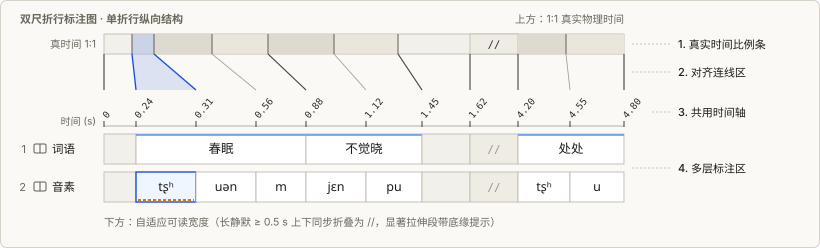
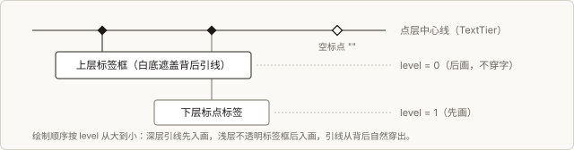

# 双尺折行标注图：完整可视化与交互编辑规范

> **方案名称**：双尺折行标注图（Dual-Scale Wrapped Score）
>
> **文档定位**：本规范完整定义了 Praat `TextGrid` 及其配套音频的可视化排版算法、声学耦合规则与直接操作编辑行为。本文独立于编程语言、界面框架与产品皮肤，适合作为桌面端、网页端及学术出版出图引擎的工程实现蓝图。
>
> 如果只需快速把握核心设计原则、保留更高实现自由度，推荐先阅读 **[核心设计规范（精简版）](./TEXTGRID_VISUALIZATION_SPEC_LITE.md)**；如需 `.TextGrid` / `.Collection` 读写细节，请见 **[Praat 文件格式规范](./PRAAT_TEXTGRID_AND_COLLECTION_SPEC.md)**。
>
> **阅读约定**：文中“须 / 应 / 不得”代表各实现共同遵守的核心规则；标注“参考默认”的像素、角度、阈值和权重为参考实现参数，可随屏幕 DPI、字体度量与平台习惯微调。

---

## 目录

1. [设计目标与核心原则](#1-设计目标与核心原则)
2. [信息映射与去冗余规则](#2-信息映射与去冗余规则)
3. [版面结构与布局算法](#3-版面结构与布局算法)
   - 3.1 [每一折行的纵向结构](#31-每一折行的纵向结构)
   - 3.2 [两种时间比例与自适应列宽求解](#32-两种时间比例与自适应列宽求解)
   - 3.3 [多行均衡折行、左侧层名栏与单行滚动](#33-多行均衡折行左侧层名栏与单行滚动)
   - 3.4 [层排列顺序（原始顺序与声学优先）](#34-层排列顺序原始顺序与声学优先)
4. [图形元素与特殊字符显示](#4-图形元素与特殊字符显示)
   - 4.1 [共用时间轴与对齐连线区](#41-共用时间轴与对齐连线区)
   - 4.2 [`IntervalTier`（区间层）图元与异常态](#42-intervaltier区间层图元与异常态)
   - 4.3 [`TextTier`（点层）图元、防越界与分层遮挡](#43-texttier点层图元防越界与分层遮挡)
   - 4.4 [特殊字符无损显示与颜色语义区分](#44-特殊字符无损显示与颜色语义区分)
5. [音频波形、语谱图与播放同步](#5-音频波形语谱图与播放同步)
   - 5.1 [语谱图、基频与共振峰计算基准](#51-语谱图基频与共振峰计算基准)
   - 5.2 [无遮挡边界刻度与中间留空的瞄准线](#52-无遮挡边界刻度与中间留空的瞄准线)
   - 5.3 [上下联动播放指针与音频硬件时钟同步](#53-上下联动播放指针与音频硬件时钟同步)
   - 5.4 [语谱图叠加曲线自动切换](#54-语谱图叠加曲线自动切换)
6. [听辨、编辑、缩放与导出行为](#6-听辨编辑缩放与导出行为)
   - 6.1 [只读听辨与局部时段放大](#61-只读听辨与局部时段放大)
   - 6.2 [三种互不干扰的缩放机制](#62-三种互不干扰的缩放机制)
   - 6.3 [原地编辑、直接拖拽与二维键盘导航](#63-原地编辑直接拖拽与二维键盘导航)
   - 6.4 [随行双尺度局部声学放大窗](#64-随行双尺度局部声学放大窗)
   - 6.5 [属性检查器、悬浮操作条与右键菜单](#65-属性检查器悬浮操作条与右键菜单)
   - 6.6 [静态插图导出与多格式保存](#66-静态插图导出与多格式保存)
7. [实现核验清单](#7-实现核验清单)

---

## 1. 设计目标与核心原则

在静态出图与长语料标注场景中，传统等宽 `TextGrid` 视图面临四个突出痛点：短音素（如 `20 ms` 塞音除阻）放不下文字，而长停顿占满画面；相邻区间与不同层之间反复印出相同时间戳；首尾空格、连续空格、真实换行和音标转义肉眼难以分辨；语谱图内部贯穿竖线容易遮挡关键声学瞬态。

**双尺折行标注图**围绕四项核心原则解决上述问题：

1. **数据完整无损**：画面能够完整还原 `TextGrid` 内的全部数据——全局时间范围 `[xmin, xmax]`、层顺序、层类型（`IntervalTier` / `TextTier`）、层名称、各层独立范围、所有精确浮点数时间戳、全部特殊字符（首尾空格、连续空格、制表符、真实换行、不可见控制符、字面引号与反斜杠、Praat 音标三字符组），以及缝隙（Gap）、重叠（Overlap）、零时长区间与空区间层等非标准状态。
2. **去掉语法与重复噪音**：省略文件头字段名、数量统计、数组下标、外层引号和同值重复时间戳。凡是可以通过空间位置、几何形状或上下对齐唯一推导的信息，都不重复印字。
3. **画布纯净与按需图例**：编辑画布只展示声学图像、必要物理量程、时间戳、层号、层名与标注内容，不放常驻装饰说明；导出论文或幻灯片插图时，可按需在图外底栏附加精简图例（仅列出当前图里真正出现的曲线与符号）。
4. **声谱真实与文字可读兼顾**：上方波形与语谱图严格按 1:1 真实物理时间绘制，确保共振峰过渡、闭塞时长与基频周期不变形；下方标注区可在**自适应宽度**（短段按字宽舒展，长静默折叠，通过对齐连线区与上方真时间相连）与**1:1 物理线性对齐**（上下完全垂直重合）之间随时切换。

---

## 2. 信息映射与去冗余规则

| 原始数据项 | 文本文件常见写法 | 双尺折行标注图表达方式 | 信息还原依据 |
| :--- | :--- | :--- | :--- |
| 文件头与字段标签 | `File type`, `xmin =`, `text =` | **省略** | 图形结构本身定义数据模型 |
| 元素计数与编号 | `size = N`, `intervals [k]:` | **省略全部区间/点编号与总数**；仅在左侧保留层的 1-based 序号 | 纵向顺序即层序，横向从左到右即区间/点序 |
| 层类型 | `"IntervalTier"` / `"TextTier"` | **几何形态区分**：区间层为上下双线封闭槽；点层为单根水平中心线 | 轨道形状与左侧类型图标一一对应 |
| 外层引号与双写转义 | `"a""b"` | **省略外层引号与转义**，直接显示字面字符 `a"b` | 区间边框与点标签框充当文本边界 |
| 空标注文本 `""` | `text = ""` / `mark = ""` | 区间层画浅灰无字封闭槽；点层在中心线上画空心菱形、不画标签框 | 有封闭槽无字即区间 `""`；空心菱形即点 `""` |
| 相邻区间共享边界 | 前段 `xmax` 与后段 `xmin` 重复 | 合并为**单根垂直分隔线** | 一根线同时代表左段终点与右段起点 |
| 跨层重合时间戳 | 多层在 `1.5` 处各自写 `1.5` | 提取到顶部**共用时间轴**，同行同值只印一次 | 任意层的竖线或锚点向上直读同一刻度 |
| 整图 `[xmin, xmax]` | 顶部元数据行 | 在共用时间轴的首尾刻度加绘**整图起止标记** | 带起止标记的刻度即整图范围 |
| 单层 `[xmin, xmax]` | 每层重复写出范围 | **按差异绘制**：与整图一致时不标记；不一致时画**单层起止标记**并给范围外填灰纹 | 无标记则等于整图范围；有标记则向上读对应时刻 |
| 跨行长区间 | 折行后重复印全句 | 完整文本只印在起始行；行尾不封口并画向右延续箭头，后续行开头画延续线与浅色摘录 | 开口延续即同一区间跨行延伸，滚动阅读仍保留上下文 |

---

## 3. 版面结构与布局算法

### 3.1 每一折行的纵向结构

长语料在纵向上折分为一行或多行。每一行内部自上而下按固定顺序排布：

#### 无音频模式（未载入音频）
1. **真实时间比例条**（参考默认高 `10–12 px`）：按 1:1 真实物理时间绘制本行范围，并用深浅色块反映下方有声标注段在真实时间中的分布。
2. **对齐连线区**（高度随最大水平偏移自动伸缩，见 4.1 节）：用直线把上方真实时间点连到下方对应列边界。
3. **共用时间轴**（高度随最长斜排数字自适应）：斜向排列本行全部唯一时间戳。
4. **多层标注区**：自上而下叠放各区间层与点层，左侧保留统一的层名栏。

#### 有音频模式（完整声学视图）
1. **波形带**（参考默认高 `20–24 px`；若用户隐藏语谱图，则隐去第 2、3 区并将波形带增高至约 `34 px`）：按 1:1 真实时间绘制振幅包络与零轴。
2. **宽带语谱图**：按 1:1 真实时间绘制 `0 Hz` 至频率上限（默认 `8 kHz`，可切换 `5 kHz / 8 kHz / 10 kHz`）的灰度语谱图，按需叠加基频与共振峰曲线。单行交互浏览时高度可随视口弹性伸展（参考 `clamp(108 px, 28 vh, 220 px)`）；多行折行与离线导出使用固定出版高度（参考默认 `108 px`，窄屏 `88 px`）。
3. **1:1 真时长对照条**（参考默认高 `7–9 px`）：紧贴语谱图 `0 Hz` 底边，按真实物理时间宽度画出最细颗粒区间层的窄色块与边界短齿，直接对照上方声学纹路。
4. **对齐连线区**：从 1:1 真时长对照条底部引出连线，衔接下方舒展后的时间列。
5. **共用时间轴**与**多层标注区**（同无音频模式）。

### 3.2 两种时间比例与自适应列宽求解

下方标注区提供两种互补的时间比例模式：

#### A. 自适应宽度模式（默认）

从整图范围、各层范围以及全部区间层的边界点中提取升序去重的时间序列 $T = [t_0, t_1, \dots, t_{M-1}]$，构成 $M - 1$ 个基础时间列 $[t_i, t_{i+1}]$。不与任何区间边界重合的孤立点层标点不切开独立时间列（仅在全文档无任何区间层时回退纳入），而是直接按所在列内的时间比例定位。

1. **长静默自动折叠（`//`）**：
   - 当文档存在有效标注、某列时长 $\Delta t_i = t_{i+1} - t_i \ge 0.5\text{ s}$（参考默认阈值）且所有可见层在 $(t_i, t_{i+1})$ 内均为空白，**并且（已载入音频时）该时段音频确无明显声音能量**时，标记为折叠静默列；全空白未标注文档及含人声的未标注录音片段均不折叠，确保初学者导入录音即可看到完整波形与语谱图。
   - 折叠静默列在上下两区同步压缩为紧凑固定宽度（参考默认 `46–52 px`），并绘制双斜杠 `//`。
2. **文字可读下限测量**：
   - 文本测宽须使用与最终画布一致的字体族、字号与字重，并预留约 `4%` 跨平台字距余量及内边距（参考默认区间左右总内边距 $\ge 20\text{ px}$，点标签 $\ge 18\text{ px}$）。
   - 非折叠列设定最小可辨识列宽 $W_{\min}$（参考默认 `17–19 px`）。对每个非空区间 $[t_a, t_b]$，测得其单行不换行所需宽度（不超过单格软折行上限 $W_{\text{wrap}}$，宽屏参考 `220 px`，窄屏按可用行宽缩减）；若当前跨越列的可读下限之和不足 $W_{\text{need}}$，将差额按各非折叠子列的时长幂权重 $q_i = (\Delta t_i)^{0.85}$ 分摊抬升各列下限：
     $$\Delta w_i = \left(W_{\text{need}} - \sum_{j=a}^{b-1} w_j\right) \cdot \frac{q_i}{\sum q}$$
     （若总权重为零则均分。）
3. **行内就近借宽（尽量保持上下对齐、减小斜线偏移）**：
   - 在确定每一行的可用内容宽度后，先以**纯线性物理时间宽度**作为各非折叠列的初始宽度 $w_{\text{lin}}(k)$（折叠静默列取与上方相同的紧凑宽度），此时每根连线都是完全垂直的、偏移为零。
   - 若某列 $w_{\text{lin}}(k)$ 小于其可读下限 $w_{\text{floor}}(k)$，记录所需补足量；大于下限的列则记为可借出的富余空间。
   - 将当前行按**折叠静默列**与**多层共享边界**切分为若干局部段落。先在各列所属的局部段落内，从左右距离最近的富余列对称借宽补足缺口；仅当单个密集段内总富余不足时，才向相邻段落溢出借宽。
   - 该机制把文字撑宽引起的横向偏移锁定在局部小范围内，使大多数边界在上下两区几乎垂直对应。
4. **显著拉伸提示**：
   - 当某非折叠列或区间的最终宽度显著大于其真实物理时间比例宽度（参考默认拉伸比 $> 1.6\times$ 且绝对增量 $\ge 8\text{ px}$）时，在区间底缘或对照条上给出柔和提示，并在悬停/属性中可查看真实毫秒时长，防止误读发音时长。

#### B. 1:1 物理线性对齐模式
- 下方标注列横坐标与上方波形/语谱图的真实物理时间坐标严格 1:1 重合，对齐连线区全部变为垂直贯通线，适合 VOT 对比、停顿比例核查与精确切音。
- 极窄区间若文字宽于格宽，须对文本做格内裁剪，防止溢出遮盖相邻区间。

### 3.3 多行均衡折行、左侧层名栏与单行滚动

系统同时支持**自动折行**与**单行展开**两种版面模式：

1. **全局均衡折行（动态规划）**：
   - 以列边界索引 $0 \dots M-1$ 为状态执行 $O(N \cdot W)$ 全局动态规划，最小化整篇折行总代价：
     $$\text{LineCost}(i \to k) = \text{BreakPenalty}(k) + \lambda_{\text{fill}} \cdot \left(1 - \frac{W(i, k)}{W_{\text{avail}}}\right)^2$$
   - 断点代价高权重惩罚切穿非空区间，轻度惩罚切穿空区间，奖励在多层共享边界与折叠静默列之后断行；同时对非末行施加填满度均衡约束（末行留出合理宽松度），使各行疏密均匀、减少首行大片空白或末行孤立短尾。
2. **窄视口连续适配**：
   - 自动折行模式下，画布宽度随窗口宽度连续调整；进入紧凑或极窄视口时，按比例收窄页边距、左侧层名栏、右悬伸留白与单格折行阈值，优先保留内容区宽度。
3. **左侧层名栏全局对齐与中段省略**：
   - 常规视口与全部导出场景中，所有行统一使用相同的完整左栏宽度，依次显示 `[右对齐层序号] + [层类型图标] + [层名称]`（空层名显示 `∅`），确保纵向浏览时每一行的时间起点严格垂直对齐。
   - 仅在极窄视口（参考宽度 `< 460 px`）下，后续行可退化为紧凑栏宽（保留序号与图标）。
   - 超长层名需要截断时，采用**中间省略**（如 `发音人…甲` / `发音人…乙`），保留首尾区分字样。
4. **单行展开、可读压缩与横向滚动**：
   - 画布窄于视口时居中显示；宽于视口时左缘紧贴正坐标起点，确保横向滚动条可以完整到达最左端层名与最右端时间戳。
   - 单行展开的最大画布宽度上限随音频/语料总时长动态放大，保证几十秒以上的长录音依然可以展开到音素级精细编辑。
   - 交互态下手动调窄单行宽度时，允许自适应模式将各非折叠列平滑压缩至可读下限总和（离线导出保持自然展开宽度）。

### 3.4 层排列顺序（原始顺序与声学优先）

- **原始顺序（默认）**：严格按文件中从上到下的原始层序排列，符合“话轮/句子 → 词语 → 音素”的常规阅读习惯。
- **声学优先（可选）**：显示语谱图时，支持把点层与切分最细密的区间层移到最上方紧贴语谱图 `0 Hz` 底边，缩短看谱对位的纵向视线距离。
- **序号保真**：开启声学优先时，左侧层号仍显示各层在文件中的真实 1-based 序号；一旦用户主动上移或下移层级以修改文件层序，视图应自动切回原始顺序，即时呈现调整结果。

---

## 4. 图形元素与特殊字符显示

### 4.1 共用时间轴与对齐连线区

1. **展示精度与固定补零**：
   - 底层内存、编辑框、复制内容、悬停提示与文件保存始终维持 IEEE-754 双精度最短无损精度（非法 `NaN` 显示 `--undefined--`）。
   - 时间轴默认采用精简小数（参考默认最多 `3` 位并去尾零），同时提供**固定小数位补零**开关（如统一显示 `2 位` 或 `3 位` 补齐尾零，学术期刊导出预设默认开启）。无论是否补零，若相邻两个不同时刻在当前精度下四舍五入后文本相同，**仅对该冲突对局部增加小数位**直至可区分。
2. **斜排刻度、点层独立刻度与防撞避让**：
   - 时间戳绕刻度点逆时针斜排（参考 `50°–55°`），顶部与最右侧按最长展示串的投影预留足够留白，避免裁切。
   - 不与区间边界重合的孤立点层标点，按其所在列内的比例位置生成轻量独立刻度，以次级优先级参与避让。
   - 相邻刻度水平间距小于防撞距（参考 `14–16 px`）时，**保留全部短刻度齿、对齐参考线与点击热区**，仅按优先级（整图首尾 > 行首尾 > 多层共享边界 > 单层边界 > 孤立点刻度）隐藏拥挤的次要数字。
3. **共同前缀弱化**：同行内，当前可见时间戳若与左侧相邻可见时间戳共享长度 $\ge 2$ 且短于全长的前缀（如 `12.5` 与 `12.545`），共同前缀用浅灰色弱化显示，变化后缀用深色加粗突出。
4. **微距错位提示**：相邻两个不同时间戳差值满足 $0 < \Delta t < 5\text{ ms}$（参考默认阈值）时，在两刻度底部之间加绘醒目短横桥，提示疑似手工对齐微偏。
5. **动态高度的对齐连线区与全边界直线**：
   - **动态高度**：自适应模式下，对齐连线区的高度根据本行内最大横向偏移量动态伸展（偏移小则紧凑省空间，偏移大则适当加高避免斜线过于扁平）；1:1 线性模式下保持紧凑定高。
   - **全边界保留连续直线**：主边界（行首尾及跨层共享边界）用清晰实线绘制，单层次级边界用较浅、较细的连续直线绘制，全部保持上下贯通可追踪，不断成残缺短桩。
   - **选中/框选焦点梯形带**：悬停、选中区间或框选播放范围时，在对齐连线区用半透明**直线多边形梯形**（连接上方真实时间区间与下方标注格起止边）高亮上下对应范围，并加粗两端连线。
6. **竖线避让时间戳**：播放指针、跨层磁吸参考线与选区边界线在自上而下穿过斜置时间戳区域时，自动在数字带位置断开避让，不斜穿或划破时间数字。

### 4.2 `IntervalTier`（区间层）图元与异常态

- **普通非空区间**：封闭上下边线与左右竖边，内部填不透明浅色或纯白底卡（遮住背后穿过的纵向参考虚线，不割裂文字），顶缘可加细层色条增强区分。
- **普通空串区间（`""`）**：保留完整封闭边框，内部填浅灰中性底色，不印字符。
- **跨行延续区间**：上一行末尾不封口并画向右箭头；下一行开头不封口，槽内画水平延续线直至真实右边界，宽度足够时在旁附带浅色斜体续接摘录（如 `…前文片段`）。
- **空区间层（0 个区间）**：上下边线画虚线空框，与“含 1 个空串区间”明确区分。
- **区间缝隙（Gap）**：缝隙处断开上下边线并填充斜纹警示底色。
- **区间重叠（Overlap）**：自动将当前层纵向拆成多个互不遮挡的子泳道，并在时间重叠段叠加斜纹警示。
- **零时长区间（`xmin == xmax`）**：在对应竖线上画窄菱形夹缝，有文本则在中心挂小标签。
- **层时间域越界（与整图范围不同）**：在层实际起止刻度画单层起止标记，范围之外填灰底网格暗纹。

### 4.3 `TextTier`（点层）图元、防越界与分层遮挡

点层由水平中心线、菱形锚点、垂直引线与标签框组成：

1. **层头热区贴合**：左侧层头的点击与高亮框紧凑包住中心线（参考上下各 `12 px`），不向下拖到多层标签底部。
2. **空标点区分**：`mark == ""` 时只画白底空心菱形；非空时画实心菱形并向下引出标签框。
3. **标签框水平防越界**：设标点横坐标为 $x_p$、标签框宽 $W_{\text{box}}$、本行内容区左右界为 $[X_{\text{left}}, X_{\text{right}}]$，标签框左缘须钳制在内容区内：
   $$X_{\text{box}} = \max\left(X_{\text{left}},\; \min(x_p - W_{\text{box}}/2,\; X_{\text{right}} - W_{\text{box}})\right)$$
   文字居中于框内，菱形锚点与引线仍落在真实位置 $x_p$，保证行首标点不撞入层名栏、行尾标点不伸出轨道。
4. **纵向错开与先下后上绘制**：按钳制后的水平范围自左向右贪心分配层数 `level = 0, 1, 2...`（同层间隔参考 $\ge 5\text{ px}$）；绘制时**按 `level` 从大到小（先画下层、后画上层）**渲染，使上层不透明白底标签自然遮盖背后的下层垂直引线，引线绝不穿过上层文字。

### 4.4 特殊字符无损显示与颜色语义区分

通过相互独立的四套颜色/符号语义，让任意字符串都能靠肉眼无歧义还原（纯黑白印刷时辅以专属符号形态）：

1. **正文字符（高对比度深色）**：逐字符对应内存中的真实字面内容（包括双引号 `"`、反斜杠 `\`、中日韩文字、国际音标与扩展字符）。
2. **空白标记（独立柔和辅色，不与选中高亮同色）**：
   - **词间单个空格**（两侧均为可见字符）：正常留白，不加符号。
   - **首尾空格、换行前后空格及连续 $\ge 2$ 个空格**：每个空格显式显示为 `␣`。
   - **真实换行 `\n`**：行尾显示 `↵` 后换行，数量和位置与原串严格一致。
   - **制表符 `\t`**：显式显示为 `⇥`。
   - **自动软折行**：上一行末尾**不加 `↵`**，新行行首前置浅色续行钩 `↪`；若折行恰好落在词间单空格后，把该行尾空格升级显示为 `␣`，且折行测宽提前算入升级增量，避免 `␣` 贴边溢出。
3. **不可见控制符与结构异常（独立警示色）**：不换行空格 `U+00A0`、零宽空格 `U+200B` 等控制字符显示为等宽标签 `[XXXX]`；缝隙、重叠、零时长、层域越界与显著拉伸提示使用警示色系。
4. **交互高亮色（独立焦点色）**：只用于选中、悬停和活动拖拽线（导出时剥离），避免选中含空格区间时混淆内容符号。
5. **Praat 反斜杠音标旁注**：文本含合法 Praat 三字符组（如 `\sh`、`\sw`、`\^h`、`\-4`）时，主行原样印出原码保证无损，上方以小号斜体辅色附注解码后的国际音标（如 `ʃ`）；导出静态图时可切换“仅显音标 / 对照显示 / 仅显原码”。

---

## 5. 音频波形、语谱图与播放同步

### 5.1 语谱图、基频与共振峰计算基准

1. **宽带语谱图与物理标尺**：
   - **预加重**：施加一阶高通预加重 $y[n] = x[n] - \alpha x[n-1]$，$\alpha = \exp(-2\pi \cdot 50 / f_s)$，提升高频擦音与高次共振峰可见度。
   - **分析窗与全局响度基准**：参考采用有效窗长约 `5 ms` 的高斯窗计算短时傅里叶变换，动态范围 `50–52 dB`；**峰值分贝须在整段音频全局统一测定**，保证折行后各行明暗标准一致。
   - **灰度映射与刻度**：低于底噪门限映射为纸白底，峰值映射为深炭黑，避免彩虹伪彩色干扰边界判读；左右内沿每 `1000 Hz` 画短齿，左沿标出 `0 Hz` 与当前上限频率（如 `5 kHz / 8 kHz / 10 kHz`，上限超过音频 Nyquist 频率时自动禁用过高档位）。
2. **基频曲线（Pitch `F0`）**：
   - 通过归一化自相关峰值拾取（如 MPM）提取浊音段基频，参考检测范围 `75–660 Hz`，经三点中值滤波去毛刺。
   - 默认纵向量程上限 `500 Hz`，当检测到更高有效基频时自动向上扩展至约 `650–700 Hz` 防止削顶。曲线底层衬以 **100% 不透明纸色描边光晕**（仅调节前景曲线透明度），确保在深黑语谱图上始终清晰；同步在图层内标出当前 `F0` 量程范围。
3. **共振峰轨迹（Formants `F1–F3`）**：
   - 降采样至约 `10 kHz` 前须施加低通抗混叠滤波（参考加窗 sinc FIR，截止频率约 `0.42 × f_eff`），随后预加重、加窗并用线性预测（参考 `10` 阶 LPC）求取包络局部极值，在有声段以离散小点标示 `F1–F3`。

### 5.2 无遮挡边界刻度与中间留空的瞄准线

- **静态零遮挡**：语谱图内部不画贯穿全高度的实线竖栏，仅在上下边框向内画短对准齿（参考 `4–6 px`；点层标点可在上沿同步画微型菱形标记），保持爆破竖纹与起振瞬态完整可见。
- **中间留空的瞄准线**：指针在语谱图内移动或拖动边界时，垂直准线在光标所在频率上下留出约 `24–28 px` 的全透明观察豁口，并在两侧画短水平准星，便于无遮挡观察目标频段细节。

### 5.3 上下联动播放指针与音频硬件时钟同步

每一行内同时存在上方的**分段线性时间坐标** $X_{\text{lin}}(t)$ 与下方的**自适应列坐标** $X_{\text{var}}(t)$：

- 时刻 $t \in [t_i, t_{i+1}]$ 在自适应列中的横坐标按列内线性插值确定：
  $$X_{\text{var}}(t) = x_i + \frac{t - t_i}{t_{i+1} - t_i}(x_{i+1} - x_i)$$
  由屏幕横坐标反推时刻 $t$ 则在对应列内做线性反解。
- **上下联动指针**：播放或定位时，指针在波形与语谱图内沿 $X_{\text{lin}}(t)$ 垂直贯穿，经对齐连线区斜向折入 $X_{\text{var}}(t)$，在下方标注区沿 $X_{\text{var}}(t)$ 垂直扫过全部层级（经过时间轴数字时自动断口避让）。
- **硬件音频时钟驱动**：载入音频时，播放启动须等待音频上下文进入运行态后再排程发声并启动游标；播放过程中游标位置**须由音频硬件输出时钟（优先取硬件输出时间戳并插值，否则取音频时钟减去基础与输出延迟）驱动**，并保持单调不回跳。音频硬件尚未唤醒或短暂挂起时，游标停驻等待，杜绝声画错位。未载入音频时回退到系统时钟驱动预览。

### 5.4 语谱图叠加曲线自动切换

提供叠加模式切换（`自动`、`音高`、`共振峰`、`纯语谱`）。在默认的**自动**模式下，随当前焦点平滑调整图层透明度：

- **无特定选中**：语谱图保持完整对比度，中透明度显示基频，隐藏共振峰。
- **选中区间层或拖动区间边界**：语谱图高对比度，清晰显示共振峰点，弱化基频曲线。
- **选中点层或编辑标点**：将语谱图压暗至约 `40%–45%` 作衬底，基频曲线提至 `100%` 前景。

---

## 6. 听辨、编辑、缩放与导出行为

### 6.1 只读听辨与局部时段放大

1. **点选即播**：只读模式下，点击有效区间即播放 `[xmin, xmax]`；点击标点从该时刻向后播放。
2. **波形/语谱图框选循环**：单击波形或语谱图跳转播放头，横向拖拉框选任意时段，配合循环与多档倍速（如 `0.5×–1.5×`）反复听辨。
3. **无损局部时段放大**：在不改动底层数据的前提下聚焦至指定时段 `[viewMin, viewMax]`，播放与编辑同步适配该窗口；对同一已放大区间再次触发“放大”入口时，可逆切换回完整时间轴。

### 6.2 三种互不干扰的缩放机制

为避免“放大画面却把自动折行压扁”或“调大按钮把画布挤歪”，系统将缩放拆分为三条独立通道：

1. **画布视觉缩放（推荐 `50%–200%`）**：
   - 由修饰键加滚轮（`Ctrl/Cmd + 滚轮`）、快捷键（`Ctrl/Cmd + = / - / 0`）及状态栏百分比控件统一控制，**只等比缩放画布内容**，不改动折行方式与外围界面大小；放大时自动提高语谱图渲染分辨率，并以鼠标位置作水平与垂直双向锚定。
   - 鼠标刻度滚轮按对称档位步进（往返必回到 `100%`），触控板双指捏合支持连续平滑缩放并在 `100%` 附近轻磁吸。
2. **时间轴密度与折行宽度**：
   - 由版面设置面板与 `Alt + 滚轮` 控制，用于在「自动折行」下调整最大折行宽度，或在「单行展开」下拉宽/压窄时间轴；宽度步进始终基于真实基准宽计算（不因多行折行后的局部实宽导致单向缩小死锁），并支持一键恢复「自动适配窗口」。
3. **外围界面大小**：
   - 在设置面板中独立提供简洁档位（参考三档：小 `100%` / 中 `120%` / 大 `140%`），只调整工具栏、侧边栏、菜单与弹窗尺寸，画布比例与导出尺寸保持独立不变。

### 6.3 原地编辑、直接拖拽与二维键盘导航

1. **无重影原地编辑**：双击或选中后按 `Enter` 在对应文字框精确位置打开输入框（`Enter` 提交，`Shift+Enter` 插入真实换行，`Esc` 取消）；打开期间隐藏底层原文字节点，防止重影。
2. **二维键盘导航与连续输入**：
   - 左右方向键 / `Tab` 在同层可见元素间移动并自动滚入视野；上下方向键按当前视觉层序跨层跳转，并以当前参考时刻落到目标层的时间重合区间或最近标点（途经空点层时保留参考时刻）。
   - 输入态下按 `Tab` 提交并进入下一格；在首行按 `↑` 或末行按 `↓` 提交并切入相邻层的时间对齐格。
   - 编辑态选中边界或标点时支持键盘毫秒微调（参考 `±10 ms` / `±1 ms`）。
3. **双空间拖拽、快捷创建与防抖锚定**：
   - 支持在标注轨与语谱图内直接拖动边界或标点；在空白区间拖拉直接新建区间并进入输入态；拖动非空区间主体保持时长不变整体平移。
   - 拖拽时严格保护边界顺序（不越界、不产生重叠或零时长）；默认开启跨层边界磁吸（屏幕距离参考 `6–8 px`），按住 `Alt` 临时自由移动，`Shift` 同步移动跨层重合边界，`Z` 吸附至附近音频过零点（参考 `±8 ms` 窗内过零插值点）。
   - **拖拽后画面不乱跳**：自适应模式下松手提交若引发列宽重排，提交前记录目标时刻的屏幕位置，在重排首帧前自动补偿滚动偏移（偏移超过参考 `4 px` 时），让刚调好的边界留在视线焦点附近。
4. **快捷切分、框选建段与显式整理**：
   - `Shift + 单击` 区间在指针处一分为二；语谱图框选落在空白区间内时可一键按框选生成区间；单击点层中心线空白处直接新建标点（悬停显示虚影预览）；删除边界自动合并相邻区间。
   - 载入含缝隙或层域不一致的文件时原样展示，不静默修改数据；提供显式「整理边界」操作供用户一键修复，全部修改可多步撤销/重做。

### 6.4 随行双尺度局部声学放大窗

已载入音频的编辑模式下，拖动边界、标点或拖拉创建/平移区间时，在操作点下方（近视口底边则自动翻至上方）随行弹出紧凑放大窗，松手即隐去：

- **上半窗（`±40 ms` 过零点波形）**：绘制前后共 `80 ms` 的高精度采样波形，并在零轴标出每个真实过零点短齿。
- **衔接桥与下半窗（`±150 ms` 宽带语谱图）**：实时绘制前后共 `300 ms` 宽带语谱图，中间以梯形衔接桥标出上半窗 `±40 ms` 在下半窗中的精确对应框（全局隐藏语谱图时仅显示上半窗波形）。
- **中空准线与微秒读数**：正中贯通中空准线，底部实时显示微秒级时刻与吸附状态。

### 6.5 属性检查器、悬浮操作条与右键菜单

1. **属性检查器与悬浮操作条**：
   - 支持侧栏属性检查器与就近悬浮操作条两种形态（宜默认侧栏，避免遮挡画布）。属性检查器呈现精确起止时刻、毫秒时长与声学快览（时长超过参考 `300 ms` 的长词句区间自动略去无代表性的单点中点共振峰，仅保留时长与基频范围）。
   - **悬浮条避开当前行**：悬浮操作条水平居中于选中项并钳制在可见视口内；纵向置于当前整行的最底缘下方，底缘空间不足时翻至整行顶缘上方，绝不遮挡同行的其他标注层。拖拽期间临时隐藏；点击空白处或按 `Esc` 立即提交编辑并收起。
2. **上下文右键菜单**：
   - 在区间、标点、边界、点层横线、层头、时间戳及空白处提供对应操作菜单（切分、合并、插点、增删层、局部播放、复制文本/时间戳与导出入口）。

### 6.6 静态插图导出与多格式保存

- 支持导出矢量图（SVG / PDF）与高分辨率位图（如 `2× / 3× / 6×` PNG），完整读写四种 `.TextGrid` 格式（长文本、短文本、二进制、按时间排序）及 `.Collection` 多对象容器。
- **导出纯净**：出图前剥离一切选中框、悬停引导、拖拽预览、播放指针与交互热区，固化当前声学图层透明度与物理量程刻度。
- **出版预设与可选图例**：提供论文黑白、演示彩图、单栏/通栏版幅预设（学术出版预设默认开启固定小数位补零），支持在图外底栏按需附带仅包含当前图所见元素的精简图例。

---

## 7. 实现核验清单

- [ ] **双模式时间轴与就近借宽**：支持自适应宽度与 1:1 物理线性对齐切换；`≥ 0.5 s` 纯静默上下同步折叠为 `//`；自适应模式在局部段落内就近借宽以降低斜线偏移，显著拉伸区间有柔和提示；线性模式极窄格文字有裁剪保护。
- [ ] **共用时间轴、全边界直线与避让**：支持精简小数与固定小数位补零，碰撞小数自动局部展开；孤立点层刻度按次级优先级避让；对齐连线区高度自适应且全部次级边界保留连续细直线，选中/框选时显示直线梯形焦点带；播放指针与参考线不划穿斜排时间戳。
- [ ] **文字测宽一致与特殊字符无损**：测宽字体与最终渲染字体完全一致；软折行行尾空格升级为 `␣` 时已预留宽度不溢出；正文、空白符号（`␣ / ↵ / ⇥ / ∅`）、控制符/异常警示与交互选中色各自独立。
- [ ] **点层防越界与分层遮挡**：首尾标点标签框不越出轨道左右边界；多层标点按先下后上顺序绘制，上层白底标签自然遮盖下层引线。
- [ ] **均衡折行、左栏对齐与单行滚动**：全局动态规划折行无孤立短尾；常规与导出场景各行左栏等宽对齐，长层名中段省略；跨行区间带延续箭头与浅色摘录；单行超宽时左右两端完整可滚达。
- [ ] **三种缩放独立无死锁**：`Ctrl + 滚轮` / `Ctrl + ±/0` / 状态栏只做画布视觉缩放（双向指针锚定、重绘高分语谱图）；`Alt + 滚轮` 与宽度步进器对称可逆无卡死，支持一键恢复自动适配；外围 UI 缩放与画布独立。
- [ ] **声学严谨与声画严格同步**：多行语谱图共用全局响度基准并标注频率/`F0` 量程，基频带不透明纸底光晕，共振峰降采样经抗混叠滤波；播放指针由硬件音频时钟驱动，等待音频就绪后再推进，不出现游标抢跑。
- [ ] **编辑流畅与导出纯净**：原地编辑无重影；自适应模式拖完边界自动补偿滚动不乱跳；悬浮条放在整行上下外缘不挡邻层；导出图不含任何交互态元素且 `.TextGrid` / `.Collection` 读写完全兼容 Praat。
