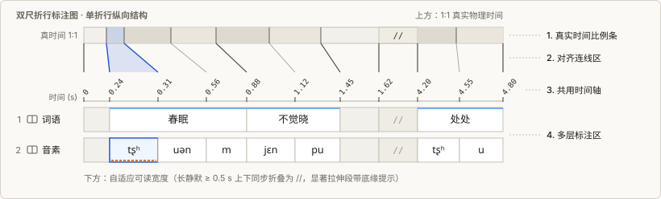

# 双尺折行标注图：核心设计规范（精简版）

> **方案名称**：双尺折行标注图（Dual-Scale Wrapped Score）
>
> **文档定位**：本文是 Praat `TextGrid` 可视化方案的**核心约定精简版**。它只保留决定读图体验与数据无损性的核心规则，不绑定任何编程语言、图形库、配色风格或界面布局，方便开发者在保持体验一致的前提下自由发挥。
>
> 若需要完整的几何公式、动态规划折行代价、声学参数与逐项验收表，请阅读 **[完整详细版规范](./TEXTGRID_VISUALIZATION_AND_EDITOR_SPEC.md)**；若需要 `.TextGrid` / `.Collection` 二进制与文本解析细节，请阅读 **[Praat 文件格式规范](./PRAAT_TEXTGRID_AND_COLLECTION_SPEC.md)**。

---

## 1. 一句话看懂这套方案

传统语音标注视图把时间轴拉成均匀等宽的一条长带：短音素挤成一团看不清，长停顿占满屏幕，多行看长句又得不停左右拖动。

**双尺折行标注图**把画面分成上下两把“尺”，并像乐谱一样自动折行阅读：

- **上面用真实时间尺（1:1 物理时间）**：波形与语谱图绝不拉伸变形，塞音闭塞、元音过渡和基频间距完全保真。
- **下面用可读文字尺（自适应宽度）**：短音段按文字宽度自动撑开，长静默（如 `≥ 0.5 s`）自动折叠成窄段 `//`，再把整段长语料均衡折成多行。
- **中间用直线连线区衔接**：每一条边界都用清晰的斜直线把上方的真实时刻连到下方对应格边；随时也可一键切回 **1:1 线性对齐** 模式，上下完全垂直对齐。

*(载入音频时，顶部第 1 区可扩展为 1:1 真实时间的波形与语谱图，其余结构完全相同。)*

---

## 2. 四条核心底线

只要守住这四条，界面风格与技术实现可以自由设计：

1. **数据完全无损**：图形能还原 `TextGrid` 中的全部信息——总起止时间、层顺序、层类型（区间层 / 点层）、层名、各层独立范围、精确时间戳、首尾/连续空格、真实换行、制表符、控制符，以及缝隙（Gap）、重叠（Overlap）、零时长区间和空层。
2. **去掉重复噪音**：不印文件头字段名、元素个数、区间下标和外层双引号；相邻区间的共享边界只画一根线；多层重合的时间戳统一提到顶部共用时间轴，只印一次。
3. **声学不失真，文字不挤叠**：波形与语谱图永远保持真实线性时间，且语谱图内部不画贯穿全高的实线（只在上下沿画短刻度齿），避免遮挡爆破线和起振瞬态；下方文字通过自适应列宽或分层标签保证清晰可读。
4. **画布纯净，导出可用**：编辑画布只放数据和必要刻度，不堆装饰性说明；导出论文或演示图时剥离所有选中框、悬停线和播放指针，可按需在图外底栏附带精简图例。

---

## 3. 数据到图形的核心映射

| 原始数据 | 图形表达 |
| :--- | :--- |
| 层类型（`IntervalTier` / `TextTier`） | 区间层用上下双线封闭长槽；点层用单根水平中心线 |
| 层序号与层名 | 左侧统一栏显示 `1-based 序号 + 类型图标 + 层名`（空层名显示 `∅`；超长层名中间省略以保留首尾差异） |
| 共享边界与重合时间戳 | 相邻区间共用一根竖线；多层同一时刻在顶部共用时间轴只标一次 |
| 空区间 `""` / 空标点 `""` | 区间层画浅灰无字封闭槽；点层在中心线上画空心菱形，不画标签框 |
| 整图与单层范围差异 | 整图首尾画起止标记；某层范围与整图不同时，在对应时刻画单层起止标记并给范围外填灰纹 |
| 跨行长区间 | 完整文本印在起始行；行尾不封口并画延续箭头，下一行开头画延续线与浅色摘要 |
| 异常结构 | **空层（0 区间）**用虚线框；**缝隙（Gap）**断开上下边线填斜纹；**重叠（Overlap）**自动拆出子泳道并标斜纹；**零时长**在竖线上画菱形夹缝 |

---

## 4. 关键视觉与排版约定

### 4.1 弹性宽度与长静默折叠
- **长静默折叠**：仅当文档已有标注内容、某段持续超过阈值（建议 `0.5 s`）且所有层为空白、并且（已载入音频时）该段确实无明显人声能量时，才在上下两区同步折叠为固定窄段并标记 `//`；未标注的新录音或全空白文档绝不折叠。
- **尽量减少斜线偏移**：自适应模式下，先按真实物理时间排布列宽，只把文字放不下的窄列撑开到刚好可读，并优先从左右相邻的宽列里**就近借宽**，避免远处边界跟着大范围漂移。
- **显著拉伸要给提示**：某段因为字宽被明显拉长（如超过真实比例的 `1.6×`）时，在底边或连线处给轻提示，避免读者把“字多占宽”误判成“发音时间长”。
- **所有边界保留细直线**：主边界与次边界在对齐连线区都保留完整细直线（通过粗细与透明度拉开层次），选中或框选片段时用直线梯形浅色带高亮上下对应区域。

### 4.2 时间刻度、点层与特殊字符
- **时间刻度**：顶部斜排显示，默认简短易读（如保留 3 位小数去尾零），并提供等宽补零模式方便论文排版；相邻两个不同时刻四舍五入撞车时，仅对该对局部多显示小数位；过于密集时保留全部刻度齿，只稀疏隐藏次要数字。播放指针、拖拽线等经过时间轴时须避让数字，不划穿文字。
- **点层标点**：非空标点在中心线画实心菱形并向下引出标签框。标签框水平位置限制在轨道内容区内（不撞进左侧层名栏或伸出右边）；多个标点靠太近时自动向下错开多层，并**先画下层、后画上层**，让上层白底标签框自然挡住下层引线。
- **特殊字符区分**：正文字符、空白标记（边界空格或连续空格显式画 `␣`，真实换行画 `↵`，制表符画 `⇥`，自动软折行在新行首画 `↪`）、不可见控制符（`[XXXX]`）与交互选中高亮**各自使用独立颜色或样式**，避免选中含空格区间时看不清符号。含 Praat 反斜杠音标（如 `\sh`）时，可保留原文并在上方附注小号国际音标 `ʃ`。

### 4.3 音频耦合与播放同步
- **语谱图与曲线**：推荐灰度宽带语谱图（全局统一响度基准，折行后各行明暗一致），边缘标注频率量程（如 `0–8 kHz`）；按需叠加基频（`F0`）与共振峰（`F1–F3`），基频线条带浅色底边防止被暗谱吞没。
- **中间留空的瞄准线**：鼠标在语谱图内移动或拖动边界时，垂直瞄准线在光标所在频率上下留出透明空档，让声学纹路零遮挡。
- **上下联动与声画严格同步**：播放指针在上方走真实时间坐标、经连线区斜折、在下方走标注格坐标。播放进度**必须由音频硬件输出时钟（扣除输出延迟）驱动**，不能靠纯系统计时器盲跑，避免音频设备唤醒慢导致游标抢跑。

---

## 5. 最小交互与缩放约定

- **只读与编辑分离**：只读态点击区间或标点直接播放，框选语谱图可循环听辨；编辑态支持双击原地改字（打开输入框时隐藏底层原字防止重影）、直接在标注轨或语谱图内拖边界、方向键与 `Tab` 二维连续跳转编辑。
- **三种缩放互不干扰**：
  1. **画布视觉缩放**（如 `Ctrl + 滚轮` / 状态栏百分比）：只等比放大或缩小画布，不改变折行结构，也不影响外部工具栏。
  2. **时间轴拉宽与折行模式**：在「自动折行」与「单行展开」之间切换，或独立调整时间轴密度，避免放大缩小出现卡死或单向收缩。
  3. **外围界面大小**：按需提供独立档位缩放菜单与面板，不影响画布与导出尺寸。
- **导出纯净**：导出矢量图（SVG/PDF）或高清位图（PNG）前，剥离全部选中框、悬停引导和播放指针。

---

## 6. 开发者可自由发挥的范围

本规范**不强制约束**以下内容，实现者可根据目标平台（桌面、网页、移动端、命令行出图脚本）和审美偏好自由决定：

- **布局求解算法**：只要满足“长静默折叠、短段可读、尽量少斜线偏移、折行均衡”，弹性列宽算法和折行算法可自行设计或简化。
- **视觉皮肤与参数**：具体字号、行高、颜色主题（浅色/深色/高对比度）、边框圆角、斜置刻度角度、具体像素留白等均可自由调整。
- **外围 UI 架构**：属性检查器放在侧边栏、悬浮条还是独立弹窗，以及工具栏排布、快捷键绑定、多标签页、主题与图标风格均不作限制。
- **进阶辅助能力**：是否提供随行声学放大镜、跨层磁吸与过零吸附、国际音标输入法、批量查找替换、自动质量诊断或 AI 辅助对齐，完全由产品定位决定。
